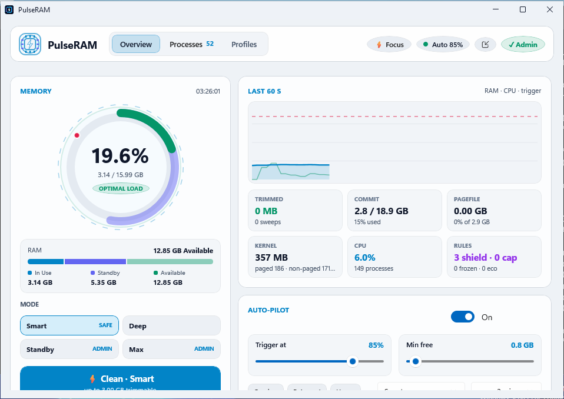
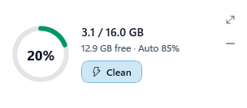

# PulseRAM ⚡

> **Intelligent Memory Optimizer & Process Governor for Windows 10 & 11**


-512BD4?logo=dotnet)


<p align="center">
  <br>
  <br>
  <sub>The dashboard and the compact widget (light theme; dark theme follows Windows).</sub>
</p>

---

## Download & Install

From the [Releases page](https://github.com/Hiirocchi18/PulseRAM/releases/latest):

| Your PC | Installer | Or portable (no install) |
|---|---|---|
| Most PCs (Intel / AMD) | `PulseRAM-Setup-v1.4.1.exe` (~22 MB) | `PulseRAM-Portable-v1.4.1-x64.zip` |
| Windows on ARM (Snapdragon, Surface Pro X …) | `PulseRAM-Setup-v1.4.1-arm64.exe` (~21 MB) | `PulseRAM-Portable-v1.4.1-arm64.zip` |

Or with winget (once the listing is approved): `winget install PulseRAM`

1. Run the installer. Until code signing is approved, Windows SmartScreen may say *"Windows protected your PC"* — click **More info → Run anyway**.
2. A short welcome card explains what PulseRAM will do on your PC.
3. For the Standby / Deep / Max purges, click **Admin** in the app (or run it as administrator).

**Portable:** unzip anywhere you can write to (e.g. *Documents* or a USB stick) and run `PulseRAM.exe`. Settings and logs stay in a `data` folder next to it; nothing is installed. Delete the folder to remove it (turn off *Start with Windows* first if you enabled it).

Requirements: Windows 10 (1809 or newer) or Windows 11, 64-bit. Nothing else to install — .NET and the Windows App SDK are bundled.

<details>
<summary><b>"The setup files are corrupted. Please obtain a new copy of the program."</b></summary>

The download didn't arrive intact — the installer checks itself and refuses to run if even one byte is missing or changed. The file on GitHub is fine.

* Check the size: right-click the file → **Properties**. It should match the size shown on the Releases page (about 22 MB for `PulseRAM-Setup-v1.4.1.exe`); smaller means the download was cut off. Download it again and let it finish.
* Or check the SHA-256 in PowerShell: `Get-FileHash .\PulseRAM-Setup-v1.4.1.exe` must match the line in `SHA256SUMS.txt` on the release.
* If the size is right but it still fails, antivirus has probably changed or locked the file. Restore it from quarantine / allow it, move it to a normal folder such as *Documents*, right-click → **Properties → Unblock**, and run it again.
* Don't run it from inside a zip, a cloud-sync folder that is still syncing, or a messaging app's preview. The portable zip is a good fallback.
</details>

---

## Overview

**PulseRAM** is a pure native Windows desktop application built with **C# (.NET 10)**, **WinUI 3 (`Microsoft.WindowsAppSDK 1.6`)**, and direct **Win32 / NT Kernel P/Invoke** (`ntdll.dll`, `psapi.dll`, `kernel32.dll`, `advapi32.dll`, `pdh.dll`).

Unlike web-wrapper or legacy WinForms RAM cleaners, PulseRAM interacts directly with the Windows NT virtual memory manager without requiring third-party drivers or web runtimes. It collects no telemetry. Its only network request is an optional once-a-day check for a new version on GitHub (see *Privacy*).

---

## Built for any PC

PulseRAM detects your hardware on first run and tunes itself — no setup needed on either a 4 GB laptop or a 64 GB workstation:

| Tier | Detected as | Auto-Pilot trigger | Free-RAM floor | Cooldown | UI |
|---|---|---|---|---|---|
| **Low-end** | < 7 GB RAM or ≤ 2 threads | 88% | 0.5 GB | 5 min | Lite |
| **Mid-range** | < 15 GB RAM or ≤ 4 threads | 85% | 0.75 GB | 3 min | Full |
| **High-end** | 16 GB+ | 80% | 1.5 GB | 2 min | Full |

Low-RAM PCs normally run at a high memory load, so they get a higher trigger and a longer cooldown — otherwise Auto-Pilot would trim all the time and make the PC slower. Profile triggers are raised by the same margin.

**Lite UI** (automatic on low-end PCs, or pick it under *Profiles → Device*) turns off ambient animations, refreshes every 3 s instead of 1.5 s, scans processes half as often, and shows fewer rows. Animations also switch off when Windows *Animation effects* is disabled. **Re-tune** on the same card restores the recommended values for your PC.

---

## What RAM trimming does (and doesn't)

Windows already manages memory well. Trimming a working set does **not** delete anything: it moves an app's pages out of physical RAM onto the standby/modified lists, and the app faults them back in the next time it touches them. That is useful when a few idle apps are crowding out the one you're using, and harmful if done constantly. PulseRAM is designed around that:

* **Smart Trim only touches idle apps**, never the window you're using, and never shielded or system processes.
* **Auto-Pilot backs off** (cooldown doubles, up to 30 min) when a sweep can't relieve pressure, instead of trimming in a loop.
* **Every number is measured.** Reported results are the working-set MB actually paged out and the measured change in Available / Free memory — no estimates.

---

## Key Features

The interface is deliberately minimal: short labels, with details in hover tooltips (mode cards, guard tiles, status chips, profiles).

### 1. Memory Reactor Radial Gauge & 60 FPS Interpolation
* **Dual Concentric Arcs**: In-use physical RAM alongside the real Windows **Standby list** size (read from the built-in `Memory` performance counters).
* **Smooth Animation Loop**: 16ms (`DispatcherQueueTimer`) LERP interpolation for fluid transitions — paused automatically while PulseRAM is hidden in the tray.
* **XAML Ambient Storyboards**: Breathing glow halo with dynamic pressure-color shifts (Optimal `#10B981`, Elevated `#F59E0B`, Critical `#F43F5E`) and continuous 360° dashed orbital ring rotation.
* **Shockwave Burst**: Triggered on every memory optimization event with spring-ease animations.

### 2. Intelligent Auto-Pilot & Active Guards
* **Configurable Thresholds**: Sweeps when memory load reaches the set percentage or Available RAM falls below the floor (defaults depend on your PC — see *Built for any PC*).
* **Adaptive Cooldown**: A minimum gap between sweeps that doubles (up to 30 min) while sweeps fail to bring memory back under the trigger, and resets once pressure clears.
* **CPU Guard**: Skips automatic sweeps while the system is busy (default ≥ 75% CPU), when extra page faults would hurt most.
* **Foreground App Shield**: Never trims the active focused window.
* **Runaway Leak Guardian**: Watches **private memory** (what grows when an app leaks) for sustained growth (default +120 MB/min over a rolling 2-minute window). It flags the app and trims its working set at most every 5 minutes. Trimming relieves physical RAM but can't release leaked memory — restart the app for that.
* **Possible leaks list** (*Processes* tab): every app caught growing is remembered with its peak growth rate, current size and when it started, and you get one notice per app (at most hourly). **Restart** asks the app to close normally — so it can save or ask you to — then starts it again; PulseRAM never force-closes anything and won't restart Windows components. **Dismiss** hides it until it starts growing again later; **Ignore** hides it for good.
* **Periodic Maintenance Timer**: Scheduled background sweeps (10m, 15m, 30m, 60m).
* **Auditory Chime Feedback**: Optional chime on automated sweeps.

### 3. Four Cleaning Modes

| Mode | What it does | Needs admin |
|---|---|---|
| **Smart Trim** (Safe) | Empties the working sets of **idle** background processes (CPU ≤ 2.5%, above a size that depends on your PC). | No |
| **Deep Sweep** (Thorough) | Trims every unshielded process. As admin, also combines identical pages, flushes the modified list, and purges the **low-priority** standby list. | For the kernel part |
| **Standby Purge** | Flushes the modified list and purges the whole standby list. Does nothing (and says so) without admin. | Yes |
| **Max Overdrive** (Extreme) | Deep trim + page combining + modified flush + **full** standby purge. | For the kernel part |

**Smart standby purge.** Emptying the standby cache only helps when free memory is actually scarce — otherwise Windows already hands out free pages and the purge just throws away useful cache, so apps reload from disk. Automatic sweeps therefore purge only when free memory is low (under ~4% of RAM) or Windows is already evicting cache (≥ 64 MB/min of repurposed standby pages, read from the kernel's memory lists like [System Informer](https://github.com/winsiderss/systeminformer) does). Manual sweeps always purge. Hover **Standby** on the dashboard to see the cache by priority and the current eviction rate.

Shielded apps, critical system processes and (by default) the foreground app are skipped in **every** mode.

### 4. Process Inspector & Quick Governor
* Searchable and sortable by **Memory**, **Smart Score**, **CPU %**, or **Leak Velocity**.
* Grouped application view or individual PID view.
* Five instant per-app actions:
  * **Trim**: Instant working set reduction (shows the MB actually paged out).
  * **Eco**: Enforces Windows EcoQoS power throttling (`PROCESS_POWER_THROTTLING_EXECUTION_SPEED`) and idle priority.
  * **Freeze / Thaw**: Suspends and resumes background processes via `NtSuspendProcess` / `NtResumeProcess`. Every frozen PID is journaled to disk, so apps are automatically resumed if PulseRAM crashes, is killed, upgraded or uninstalled.
  * **Cap**: Sets a **hard per-process** working-set ceiling in MB (`QUOTA_LIMITS_HARDWS_MAX_ENABLE`). Windows enforces it continuously; PulseRAM checks once a minute and applies it only to new processes of the app. A cap that's too low makes the app page heavily.
  * **Shield**: Whitelists applications from all Auto-Pilot sweeps.

### 5. Workload Profiles, Global Hotkeys & Tray
* **Pre-configured Workloads**: Gaming Boost (68%), Creator & 3D Studio (72%), Dev & Local AI (76%), and Browser Tab Tamer (78%). A matched profile temporarily shields its running EXEs while it is active.
* **Global Hotkeys** (configurable via `HotkeyPrimary` / `HotkeySecondary` in `%LocalAppData%\PulseRAM\pulseram_config.json`, e.g. `"Ctrl+Alt+Shift+M"`, `"Ctrl+Win+F9"`):
  * `Ctrl + Alt + Shift + M`: Smart Trim of idle background apps.
  * `Ctrl + Alt + Shift + P`: Deep Sweep.
  * The defaults avoid `Ctrl+Shift+M` (Teams mute) and `Ctrl+Shift+P` (VS Code command palette). If a hotkey is already taken, PulseRAM tells you instead of failing silently.
* **Live tray icon**: shows the current RAM % (green → amber → red with memory pressure), drawn crisply for any display scaling. Live tooltip and a quick-action menu; launching PulseRAM again brings the existing window forward.
* **Minimize to tray** (on by default): the window's minimize button hides PulseRAM to the tray, where it keeps running; click the tray icon to bring it back. Untick *Profiles → Device → Minimize to tray* to minimize to the taskbar instead.
* **Light in the tray**: while hidden, PulseRAM stops drawing its UI and runs itself in Windows **Efficiency Mode** (EcoQoS, below-normal priority).

### 6. Compact widget
* The **compact** button (next to *Auto* in the top bar) turns PulseRAM into a small always-on-top widget, about 300 × 100: a RAM ring with the %, used / total, free memory and Auto-Pilot status, and one **Clean** button for the selected mode.
* No title bar — drag it by its body, **double-click** it (or press ⤢) to return to the full view, or press — to hide it to the tray.
* It remembers where you put it (top-right corner the first time), and only refreshes the numbers it shows, so it costs less CPU than the full window.
* **Right-click** it for the clean mode, Focus Boost, Auto-Pilot, *See-through when idle* (it fades to translucent while the mouse is elsewhere), full view and hide.
* Start straight into it with `PulseRAM.exe --compact` (e.g. in a shortcut).

### 7. Memory-limit warning
* RAM % isn't what makes apps crash — the **commit limit** (RAM + page file) is. When committed memory passes 90% (critical at 96%), PulseRAM shows a banner (or a Windows notification while it's in the tray) with advice that fits your PC: no page file, a page file capped too low, or which app is using the most. One click opens the page-file settings. Trimming can't fix this, and PulseRAM says so. Toggle: *Profiles → Device → Memory warnings*.

### 8. Feels native
* **Light and dark theme** — follows Windows by default and switches live; or pick Dark/Light under *Profiles → Device*.
* **Remembers its window** — size, position and maximized state are restored (safely re-centred if that monitor is gone), with a sensible minimum size.
* **Update notice** — once a day PulseRAM asks GitHub whether a newer release exists and shows a small banner with *Download* (opens the release page) and *Skip this version*. It never downloads or installs anything by itself. Turn it off with *Profiles → Device → Updates*, or click *Check now*.
* **Crash log** — errors are written to `%LocalAppData%\PulseRAM\logs` (kept 7 days) instead of being silently ignored, and PulseRAM tells you if the last session ended unexpectedly. *Profiles → Device → Logs* opens the folder.

### 9. Windows Startup
* Toggle **Windows Startup** on the dashboard. It normally uses the per-user `HKCU\...\Run` key and starts as a standard user.
* **Starting as administrator at logon** (so Standby/Deep/Max purges work after a reboot) needs an **all-users install** — choose *Install for all users* in the installer, which puts PulseRAM in *Program Files*. Then, with PulseRAM running as administrator, turn on Windows Startup and it registers an elevated Task Scheduler task (`PulseRAM Elevated Startup`).
  * PulseRAM refuses to do this for per-user or portable copies: their files can be changed by any program you run, so an automatic admin start would let such a program gain administrator rights. Older versions allowed it; PulseRAM 1.4.1 removes such a task the next time it runs as administrator, and the uninstaller removes it too.

---

## Settings & Data

| File | Location | Purpose |
|---|---|---|
| `pulseram_config.json` | `%LocalAppData%\PulseRAM\` | Your settings, plus window and compact-widget positions (always writable, even for an all-users install). |
| `frozen_processes.json` | `%LocalAppData%\PulseRAM\` | Journal of PIDs PulseRAM has frozen; used to resume them after a crash. |
| `logs\pulseram-*.log` | `%LocalAppData%\PulseRAM\` | Startup info, every sweep, warnings and errors (7 days, 2 MB per file). Attach these to bug reports. |
| `pulseram_defaults.json` | Install folder | Defaults applied on first run. Settings saved by v1.0 next to the EXE are imported once. |

In the **portable** version all of these live in the `data` folder next to `PulseRAM.exe` (enabled by the `portable.txt` file there).

Command-line switches: `--tray` (start hidden in the tray), `--compact` (open as the compact widget), `--thaw-frozen` (resume anything PulseRAM left suspended, then exit; used by the installer).

---

## Architecture & Kernel APIs

PulseRAM operates directly against official Windows NT subsystem and Win32 APIs:

| Subsystem | API | Purpose |
|---|---|---|
| `kernel32.dll` | `GlobalMemoryStatusEx` | Real-time physical RAM and pagefile metrics |
| `pdh.dll` | `PdhAddEnglishCounter` (`\Memory\Standby Cache *`, `\Memory\Free & Zero Page List Bytes`) | Real Standby and Free list sizes (no admin needed) |
| `psapi.dll` | `GetPerformanceInfo`, `EmptyWorkingSet` | Working set trimming and kernel commit loads |
| `kernel32.dll` | `SetProcessWorkingSetSizeEx` | Hard per-app working-set ceilings |
| `ntdll.dll` | `NtSetSystemInformation` | Standby cache purge, modified flush and physical memory page combining |
| `ntdll.dll` | `NtSuspendProcess`, `NtResumeProcess` | Process freezing and thawing |
| `kernel32.dll` | `SetProcessInformation` | EcoQoS efficiency mode power throttling |
| `advapi32.dll` | `AdjustTokenPrivileges` | `SeProfileSingleProcessPrivilege` & `SeIncreaseQuotaPrivilege` |

---

## Building from Source

### Prerequisites
* Windows 10 (Build 19041+) or Windows 11
* [.NET 10 SDK](https://dotnet.microsoft.com/download/dotnet/10.0)
* Visual Studio 2022/2026 with the *Windows application development* workload (the WinUI resource tools ship with it)
* [Inno Setup 6](https://jrsoftware.org/isinfo.php) (for building the installer)

### Build Commands
```powershell
# Clone the repository
git clone https://github.com/Hiirocchi18/PulseRAM.git
cd PulseRAM

# Build Release binaries
dotnet build -c Release -r win-x64

# Installer + portable zip (x64, or -Arch arm64)
.\Build-Installer.ps1

# Unit tests (any OS)
dotnet test tests/PulseRAM.Tests/PulseRAM.Tests.csproj
```

Output: `dist\PulseRAM-Setup-v1.4.1.exe` and `dist\PulseRAM-Portable-v1.4.1-x64.zip` (`-arm64` for ARM).

**Code layout:** `NativeMemoryEngine.cs` (memory engine), `Core/` (pure decision logic — tiers, purge policy, commit warning, back-off, hotkeys, versions, leak history — covered by `tests/`), `MainWindow.*.cs` (UI, one file per area), `UpdateChecker.cs`, `Log.cs`.

**CI** (`.github/workflows/build.yml`): unit tests, then x64 (on `windows-latest`) and ARM64 (on GitHub's ARM runner) builds, each with launch tests (first run, live theme switch, update check, compact widget, screenshots), the portable zip test and a silent install → launch → uninstall test.

**Releases** (`.github/workflows/release.yml`): publishing a GitHub release builds and tests both architectures, signs them (once SignPath is set up — [docs/SIGNING.md](docs/SIGNING.md)), attaches the installers, portable zips and `SHA256SUMS.txt` to the release, and updates winget ([winget/README.md](winget/README.md)). See [CHANGELOG.md](CHANGELOG.md) for what changed in each version.

---

## Privacy

PulseRAM collects no telemetry and sends no information about you or your PC anywhere. Its only network request is the optional daily update check: a plain HTTPS request to `api.github.com` for the latest PulseRAM release, which you can turn off in the welcome card or under *Profiles → Device → Updates*.

## Security

* When running as administrator, PulseRAM only caps, freezes or throttles apps in **your own desktop session** — never Windows services or security software — even if its settings file is edited by another program.
* It won't follow links (junctions/symlinks) planted in its data folder, and opens web pages and folders through Explorer so they don't inherit administrator rights.
* The automatic "start as administrator" task is only created for all-users installs in Program Files (see *Windows Startup*).
* Found a security problem? Please report it privately via GitHub's **Security → Report a vulnerability** on this repository instead of opening a public issue.

## Code signing policy

Free code signing provided by [SignPath.io](https://about.signpath.io/), certificate by [SignPath Foundation](https://signpath.org/) *(pending approval — until then releases are unsigned)*.

* Committers and reviewers: [Hiirocchi18](https://github.com/Hiirocchi18)
* Approvers: [Hiirocchi18](https://github.com/Hiirocchi18)

Every signed release is built by GitHub Actions from this repository's source ([release.yml](.github/workflows/release.yml)) and approved manually before signing.

---

## License

Distributed under the MIT License. See [LICENSE](LICENSE) for more information.
